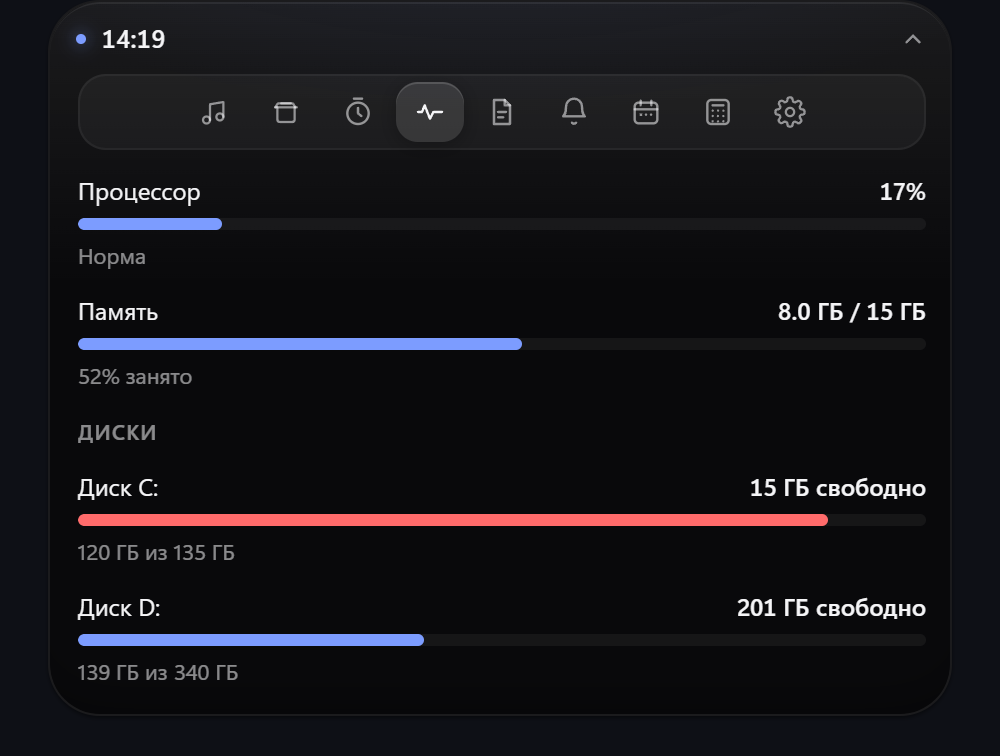
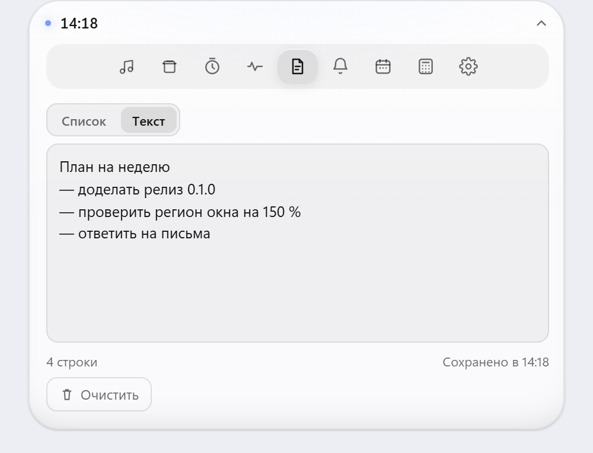
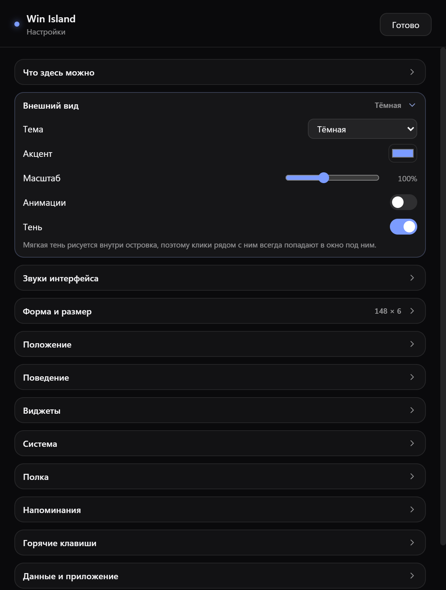

<div align="center">

# Win Island

**Dynamic Island для Windows 11.**
Одна морфящаяся поверхность: в покое — тонкая линия, при наведении раскрывается
в панель с музыкой, файлами и инструментами.


[Возможности](#возможности) · [Установка](#установка) · [Сборка](#сборка) · [Свои виджеты](docs/SDK.md)

</div>

| Тёмная тема | Светлая тема |
|:---:|:---:|
|  |  |

## Возможности

- **Тонкая линия в покое**: свёрнутое состояние по умолчанию — полоска 148 × 6,
  которая не перекрывает вкладки браузера. Ширина, высота, отступ и скругление
  настраиваются; есть классический режим «пилюля» с часами и мини-индикаторами.
- **Морфинг** формы (линия/пилюля ↔ панель) с настраиваемой скоростью и типом easing.
- **Медиа**: текущий трек из любого плеера через системный SMTC — обложка, название,
  исполнитель, перемотка, play/pause, следующий/предыдущий, выбор источника.
  В свёрнутой пилюле — обложка и название (в режиме «линия» мини-индикаторов нет).
- **Полка файлов**: перетащите файлы на островок (или вставьте из буфера) — они
  останутся на полке после перезапуска. Файл можно **вытащить обратно настоящим
  перетаскиванием** — в Проводник, на рабочий стол, в другое приложение (OLE,
  копирование). Ещё: копирование в буфер (`CF_HDROP`), открытие, «показать в
  папке». Два режима отображения — список или превью (миниатюры фото и кадр
  видео).
- **Виджеты**: таймер, калькулятор, системный монитор, заметки, напоминания,
  календарь, настройки.
- **Таймер**: только цифры, без «±». Пресеты прибавляют время (`5 → 5:00`,
  `+10 → 15:00`), `Shift` — вычитают (`15:00 → 10:00`; ниже нуля на паузе
  сбрасывает на `1:00`). На ходу те же кнопки добавляют и отнимают время.
  Ручной ввод — до четырёх цифр `ММСС` с автоматическим двоеточием, секунды
  больше 59 прижимаются к 59. Пока зажат `Shift`, рядом с цифрами и на кнопках
  виден «−». Введённое применяется сразу: «Старт» и пресеты забирают цифры из
  поля, а простой фокус и уход из поля не сбрасывают поставленный на паузу
  отсчёт. `Esc` возвращает в поле текущее время.
- **Заметки**: два независимых режима. Текст остаётся текстом (не превращается
  в пункты), чек-лист живёт отдельно: `Enter` добавляет пункт, `Backspace` в
  пустом удаляет, счётчик «1 из 3 готово». Кнопка очистки убирает выполненные
  пункты, а с `Shift` — вообще все (и становится красной). В режиме текста та же
  кнопка очищает текст.
- **Календарь**: сетка месяца с точками на днях с планами; на выбранный день —
  список дел. Время можно не указывать (такие задачи идут в конце), у задачи
  есть приоритет: важные всегда сверху и крупнее — иконка, чекбокс, шрифт.
- **Напоминания со звуком**: выбор сигнала (мягкий звонок, колокольчик, щелчок,
  тревога, без звука), громкость и режим «звук не замолкает». Пока он включён,
  напоминание повторяется каждые 4 секунды, а над вкладками висит баннер с
  кнопкой «Остановить» — панель не свернётся сама, пока вы её не нажмёте.
- **Системный монитор**: процессор, память, время работы и занятое место на
  дисках (свободно / занято из всего, с полосой). Каждый показатель включается
  и выключается в настройках.
- **Звуки интерфейса**: короткие синтезированные звуки на раскрытие, сворачивание,
  смену вкладки и сброс файла в полку; включаются/выключаются и регулируются по
  громкости в настройках.
- **Настройки в отдельном окне** (`Ctrl+Alt+S`): высокое окно с прокруткой, которое
  не растягивает островок; изменения применяются сразу и синхронизируются с панелью.
  Там же кнопки «Развернуть островок» и «Свернуть островок».
- **Темы и акцент**: стекло / тёмная / светлая, свой цвет акцента, прозрачность, масштаб.
  Тень островка включается и выключается (`Тень` в настройках).
- **Позиция**: центр / смещение, отступ сверху, перетаскивание пилюли (если позиция не зафиксирована).
- **Мульти-монитор**: основной, монитор активного окна, конкретный монитор + слежение за активным окном.
- **Скрытие**: в полноэкранных приложениях и (опционально) в максимизированных окнах.
- **Автоскрытие** после бездействия.
- **Глобальные хоткеи**: `Ctrl+Alt+Space` — показать/скрыть, `Ctrl+Alt+H` — скрыть, `Ctrl+Alt+S` — настройки.
- **Трей**: показать/скрыть, настройки, папка данных, выход.
- **Хранение**: настройки и данные виджетов в `data/` (JSON), ничего в реестре.
- **Кликается ровно островок**: окно обрезано оконным регионом по прямоугольнику
  островка — ни запаса под тень, ни невидимых полей. Всё, что вокруг, принадлежит
  системе: вкладки браузера, рабочий стол, другие окна. Окно помечено как
  `WS_EX_TOOLWINDOW`, поэтому в панели задач и в Alt+Tab его нет.

## Настройки

Отдельное нативное окно: длинный список опций прокручивается, а островок
остаётся маленьким. Изменения применяются сразу и без перезапуска, разделы
раскрываются по одному, свёрнутые не попадают в `Tab`.

<p align="center">
  
</p>

## Как пользоваться

- Наведите курсор на тонкую линию — панель раскроется; `Esc` или стрелка справа сворачивает.
  Пока звенит напоминание, панель остаётся открытой: сначала «Остановить».
- **Медиа**: включите трек в любом плеере, который видит Windows (Spotify, браузер,
  AIMP, VLC) — обложка и название появятся сами, перемотка и кнопки работают
  прямо из островка.
- **Полка**: перетащите файлы на островок или нажмите значок буфера в разделе
  «Полка», чтобы добавить файлы, скопированные в Проводнике. Файл с полки можно
  утащить мышью: нажмите на него и тащите — островок не свернётся, пока кнопка
  зажата. Вид полки (список или превью) переключается в настройках.
- Остальные разделы — вкладки в верхней строке панели.
- **Настройки** открываются отдельным окном: значок шестерёнки на вкладке
  «Настройки», `Ctrl+Alt+S` или правый клик по иконке в трее. Там же — раздел
  «Напоминания» с прослушиванием сигнала прямо из окна. «Готово» прячет окно:
  следующий вызов открывает его мгновенно, с уже выбранным разделом.
- **С клавиатуры**: `Tab` доводит до ленты вкладок (в ней одна остановка),
  `←`/`→` переключают разделы, `Home`/`End` прыгают к краям, `Enter`/`Space`
  нажимают кнопку. Фокус подсвечивается рамкой акцентного цвета. `Esc` сначала
  закрывает то, что открыто (ввод времени, запись хоткея, поповер), и только
  потом сворачивает островок. Разделы настроек — настоящие disclosure-кнопки
  (`aria-expanded`/`aria-controls`), свёрнутое содержимое выпадает из `Tab`;
  файлы на полке и мини-чипы в пилюле открываются `Enter`/`Space`; перемотка
  медиа — стрелки (`Shift` — крупный шаг), `Home`/`End`. В окне настроек `Esc`
  закрывает окно (запись хоткея забирает `Esc` первой).
- Если в Windows включено «Уменьшить движение», анимации выключаются сами —
  независимо от настройки внутри приложения.

## Установка

Готовый инсталлятор — в разделе [Releases](https://github.com/dubrik-agent/win-island/releases):
`Win Island_0.1.0_x64-setup.exe`, около 1.6 МБ, Windows 10/11 x64.
Права администратора не нужны, WebView2 в Windows 11 уже есть. Автозапуск и
ярлык на рабочем столе — по желанию, в конце установки.

## Запуск (разработка)

Нужны Node.js 20+, [Rust](https://rustup.rs) (stable, `x86_64-pc-windows-msvc`)
и Visual Studio Build Tools с компонентом «Разработка классических приложений
на C++».

```powershell
git clone https://github.com/dubrik-agent/win-island.git
cd win-island
npm install
npm run tauri dev
```

`scripts\env.cmd` нужен только для портативного набора инструментов: если Rust,
Node и Git лежат в `%USERPROFILE%\AI\tools`, скрипт добавляет их в `PATH` и
собирает проект в этой папке. Без такой папки он ничего не меняет — обычная
установка работает и так. Вызывать его нужно в том же окне консоли, перед `npm`:

```powershell
.\scripts\env.cmd
npm run tauri dev
```

## Сборка

```powershell
npm run tauri build
```

Инсталлятор появится в `src-tauri\target\release\bundle\nsis`. Если задан
`CARGO_TARGET_DIR` (например, в `scripts\env.cmd`), папка сборки будет там.

## Данные

```
data/settings.json     настройки (вид, форма, звук напоминаний, хоткеи)
data/store/notes.json  заметки (текст и чек-лист отдельно)
data/store/reminders.json напоминания
data/store/calendar.json  планы по дням
data/store/shelf.json  файлы на полке
data/store/widgets.json   включённые виджеты
data/logs/win-island.log  журнал: старт, хоткеи, смена монитора, ошибки UI
```

Журнал ротируется на 256 КБ (`win-island.log.1`) и открывается кнопкой «Логи»
в настройках — его можно приложить к отчёту об ошибке.

Каждый файл пишется атомарно: временный файл → `sync_all` → прежняя версия
переименовывается в `*.bak` → новая встаёт на место. Если питание пропадёт
посреди записи, при следующем запуске читается `.bak`, а не пустой файл.
Ошибки чтения и записи сторов попадают в журнал, а не только в консоль.

Портативно: в релизе папка `data` создаётся рядом с `exe`; если туда нельзя
писать (например, `Program Files`), используется `%LOCALAPPDATA%\WinIsland\data`.

## Горячие клавиши

| Комбинация | Действие |
|---|---|
| Ctrl+Alt+Space | показать / скрыть |
| Ctrl+Alt+H | скрыть |
| Ctrl+Alt+S | открыть настройки |
| Esc | свернуть (когда островок в фокусе) |

## Ограничения текущей версии

- Эксклюзивный полноэкранный режим некоторых игр может перекрывать островок —
  в этом случае он скрывается по настройке.
- Пользовательские виджеты из папки (экспериментальный режим) ещё не реализованы:
  контракт описан в `docs/SDK.md`, загрузчик появится позже.
- Виджет паролей KeePassXC (только чтение и копирование) — следующий этап.
- Автозапуска с Windows пока нет: приложение запускается вручную или ярлыком
  в автозагрузке.
- **Медиа** видно только от плееров, которые публикуют сессию в SMTC. Spotify,
  браузеры (YouTube/Яндекс Музыка во вкладке), AIMP, VLC, Media Player — да;
  старые или «тихие» плееры могут не отдавать трек.
- **Полка** отдаёт файлы настоящим OLE-перетаскиванием (PIDL → `SHCreateDataObject`
  → `DoDragDrop`), поэтому файл можно бросить в любое приложение, а не только
  скопировать в буфер. «Показать в папке» работает через `SHOpenFolderAndSelectItems`
  по полному PIDL: два одноимённых файла в разных папках не путаются, а
  отсутствующий файл даёт ошибку вместо «Документов».
- Полка хранит только пути: если файл переместили или удалили, запись исчезнет
  при следующем открытии.

## Как это устроено

- Окно прозрачное, без рамки, always-on-top; размер окна = размеру островка плюс
  небольшой запас под тень, но **кликабельная область — ровно островок**:
  `SetWindowRgn` обрезает окно по его прямоугольнику (скругление = радиусу
  островка). Запас нужен только чтобы не обрезать размытие тени внутри окна.
- Тень нарисована **внутри** островка (`--shadow` в `styles.css`), поэтому ей не
  нужны внешние поля: любое поле снаружи — это площадь, по которой нельзя
  кликнуть. Настройка «Тень» снимает `box-shadow` целиком.
- Морфинг: окно ресайзится **до** старта CSS-перехода, чтобы кадры не обрезались,
  а регион ставится на финальный прямоугольник; при сворачивании окно остаётся
  большим до конца перехода. Пока идёт морф, `requestResize()` заблокирован —
  иначе второй переход дёргает форму. Кривая `cubic-bezier(0.22, 1, 0.36, 1)`,
  содержимое панели выезжает со стаггером.
- Свёрнутая форма: тонкая линия (`lineWidth × lineHeight`, скругление = высота/2)
  или пилюля с часами и до двух мини-индикаторов (`pillWidth × pillHeight`).
- Окно настроек — отдельное нативное окно Tauri (`label: settings`), поэтому
  длинный список опций прокручивается, а островок остаётся маленьким. Оба окна
  обмениваются событиями `island://settings-changed`, `island://widgets-changed`.
- Звуки напоминаний синтезируются через WebAudio (`core/sound.ts`), без аудиофайлов.
  Если WebView2 ещё не разблокировал звук до первого клика, используется
  системный `MessageBeep`.
- **Медиа** идёт через WinRT `GlobalSystemMediaTransportControlsSessionManager`
  в отдельном модуле `media.rs`; вызовы уходят с UI-потока в blocking-пул,
  обложка кэшируется по треку и отдаётся как data-URL.
- **Полка** использует Win32 `CF_HDROP` для буфера, `ShellExecuteW` для
  открытия и `SHOpenFolderAndSelectItems` — чтобы показать файл в папке.
  Перетаскивание наружу — модуль `dragdrop.rs` (OLE на рабочем потоке).
- Смену монитора, выход из сна и смену масштаба Windows ловит фоновый поток:
  он сравнивает отпечаток монитора (позиция, рабочая область, DPI) каждые
  700 мс и просит фронтенд пересчитать границы и кликабельную область.
- Ошибки Rust и фронтенда пишутся в `data/logs/win-island.log`, поэтому
  «белое окно» и неработающий хоткей можно разобрать по файлу, а не по памяти.

## Структура

```
src/                 фронтенд (Vite + TS, без фреймворка)
  core/api.ts        типизированные вызовы Rust
  core/island.ts     морфинг и размеры окна
  core/sound.ts      синтез сигналов напоминаний и звуков интерфейса
  core/alarm.ts      баннер будильника, повтор и удержание панели
  core/widget-manager.ts  жизненный цикл виджетов, вкладки, мини-индикаторы
  core/escape.ts     стек Esc-слоёв (поповер/редактор забирает Esc первым)
  core/motion.ts     «уменьшить движение» из Windows поверх настройки приложения
  core/strings.ts    общий словарь кнопок и подсказок
  settings-window.ts отдельное окно настроек
  widgets/           встроенные виджеты (media, shelf, timer, notes, calendar, …)
src-tauri/src/       Rust: окно, трей, хоткеи, фуллскрин, метрики, SMTC
  media.rs           now playing через WinRT
  dragdrop.rs        OLE-перетаскивание файлов из полки наружу
  winapi_ext.rs      Win32: оконный регион, буфер файлов, shell, диски
scripts/             QA-хелперы: env.cmd, hit-test, capture-island, cdp.mjs
docs/SDK.md          как писать свои виджеты
docs/img/            снимки для этого README
```

## Свои виджеты

Виджет — это объект с `mount()`/`unmount()` и парой необязательных методов
(`onShow`, `requestResize`, мини-индикатор для свёрнутой пилюли). Контракт,
правила стилей и готовый пример — в [`docs/SDK.md`](docs/SDK.md).

Встроенные виджеты лежат в `src/widgets/`, порядок и видимость настраиваются
в окне настроек (перетаскиванием строк или стрелками).

## Лицензия

MIT — см. [`LICENSE`](LICENSE).
